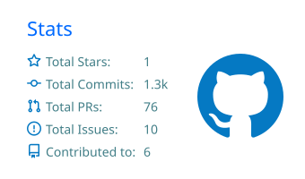
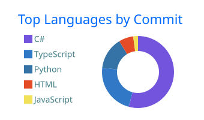

<div align="center">


<sub>Backend Developer na <b>SISqualis</b> · Bacharelado em Inteligência Artificial na <b>Unisinos</b></sub>

</div>

<br>

```yaml
foco:      APIs, processamento de dados massivo, integrações legadas
dia a dia: fluxos complexos, workers e integrações entre APIs
ia:        SLMs, NLP, JEPA, R
infra:     kubernetes, cloud, sql tunnig
```

<br>

<div align="center">

<br>
<sub><code>backend dev</code></sub>

<br><br>





<br><br>

<picture>
  <source media="(prefers-color-scheme: dark)" srcset="https://raw.githubusercontent.com/derik-martins/derik-martins/output/snake-dark.svg" />
  <source media="(prefers-color-scheme: light)" srcset="https://raw.githubusercontent.com/derik-martins/derik-martins/output/snake.svg" />
  
</picture>

<br><br>

<a href="https://www.linkedin.com/in/SEU_LINKEDIN">linkedin</a> &nbsp;·&nbsp;
<a href="mailto:seu@email.com">e-mail</a> &nbsp;·&nbsp;
<a href="https://github.com/derik-martins">github</a>

<br><br>


</div>
